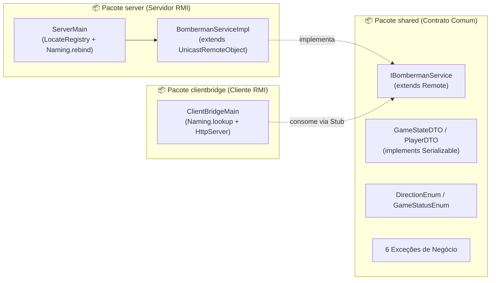
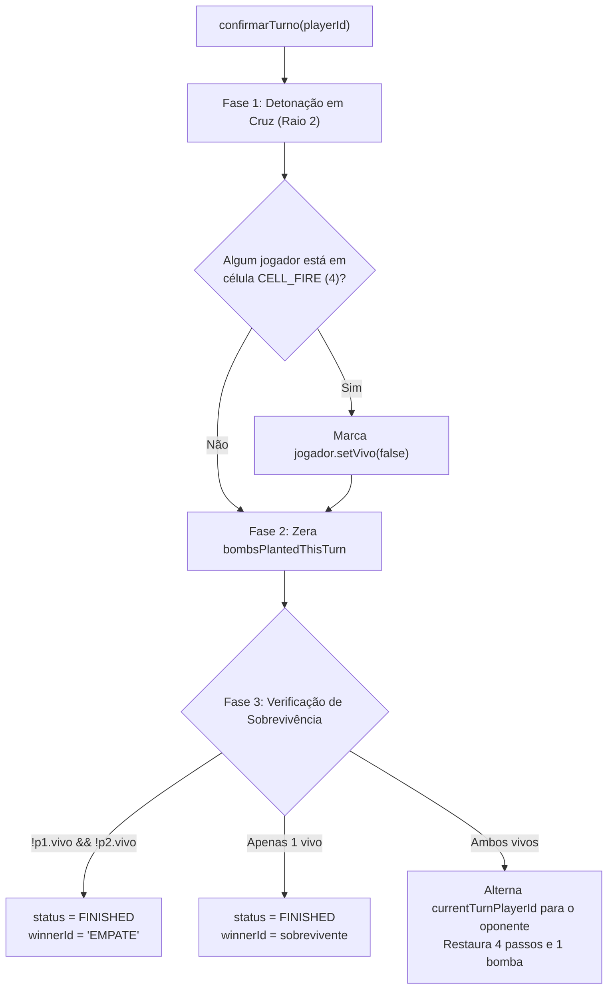

# Guia de Estudo do Backend: Bomberman 1v1 com Java RMI

Este documento foi preparado para ajudar **você e o Kauã** a dominarem cada linha do backend (`backend-rmi`), entenderem os conceitos de **Sistemas Distribuídos (Java RMI)** cobrados na disciplina e responderem com segurança qualquer pergunta do professor na apresentação/arguição.

---

## 1. Visão Geral da Estrutura de Pacotes (`backend-rmi`)

O backend está dividido em **3 pacotes principais** dentro de `backend-rmi/src/main/java/`:



| Pacote | Papel no Sistema Distribuído | Principais Arquivos |
| :--- | :--- | :--- |
| **`shared`** | **Contrato Compartilhado:** Tudo que tanto o Cliente quanto o Servidor precisam conhecer (Interface Remota, DTOs serializáveis, Enums e Exceções). | `IBombermanService.java`, `GameStateDTO.java`, `PlayerDTO.java`, `DirectionEnum.java`, `GameStatusEnum.java` + Exceções |
| **`server`** | **Servidor Autoritativo RMI:** Cria o Registry na porta `1099`, instancia o objeto remoto e executa toda a regra de negócio da matriz `9x9` com controle de concorrência. | `ServerMain.java`, `BombermanServiceImpl.java` |
| **`clientbridge`** | **Cliente RMI + Adaptador HTTP:** Conecta no servidor RMI via protocolo **JRMP** (`Naming.lookup`) obtendo o **Stub**, e abre uma porta HTTP local (`8081`/`8082`) para o navegador (React) conversar via JSON. | `ClientBridgeMain.java` |

---

## 2. Os 5 Conceitos de Java RMI que Vocês Precisam Saber Explicar

### 2.1. `java.rmi.Remote` e `RemoteException` (`IBombermanService.java`)
Para que uma interface Java possa ter seus métodos chamados através da rede:
1. Ela **obrigatoriamente** deve estender `java.rmi.Remote`.
2. **Todos** os métodos dela devem declarar `throws RemoteException` na assinatura.
   - **Por quê?** Porque chamadas de rede podem falhar por motivos físicos (cabo desconectou, servidor caiu, timeout de TCP). O Java RMI força o programador a tratar essas falhas de comunicação.

```java
public interface IBombermanService extends Remote {
    PlayerDTO conectarJogador(String nome) throws RemoteException, GameFullException;
    GameStateDTO mover(String playerId, DirectionEnum direcao) throws RemoteException, ...;
    GameStateDTO plantarBomba(String playerId) throws RemoteException, ...;
    GameStateDTO confirmarTurno(String playerId) throws RemoteException, ...;
    GameStateDTO obterEstadoJogo() throws RemoteException;
    void desconectarJogador(String playerId) throws RemoteException;
    GameStateDTO reiniciarPartida() throws RemoteException, InvalidTurnException;
}
```

### 2.2. `UnicastRemoteObject` (`BombermanServiceImpl.java`)
A classe `BombermanServiceImpl` implementa `IBombermanService` e herda de `UnicastRemoteObject`:
```java
public class BombermanServiceImpl extends UnicastRemoteObject implements IBombermanService
```
- **O que o `super()` do `UnicastRemoteObject` faz no construtor?**
  Ele **"exporta"** o objeto na JVM do servidor: abre um socket TCP anônimo para escutar chamadas remotas via protocolo **JRMP (Java Remote Method Protocol)** e gera automaticamente o par **Stub/Skeleton** dinâmico.

### 2.3. `Serializable` e Passagem por Valor vs. Passagem por Referência
No Java RMI existem dois tipos de objetos que trafegam na rede:
1. **Objetos Remotos (`IBombermanService`):** São passados **por referência remota**. O objeto `BombermanServiceImpl` nunca sai do servidor; o cliente recebe apenas um *Stub* (ponteiro de rede) que aponta para o servidor.
2. **Objetos de Dados (`GameStateDTO`, `PlayerDTO`, `DirectionEnum`, Exceções):** Implementam `java.io.Serializable` e são passados **por cópia/valor** (*deep copy*).
   - Quando o servidor retorna `GameStateDTO`, o RMI converte o objeto inteiro em bytes (**Marshaling**), envia pelo socket TCP, e o cliente reconstrói uma cópia idêntica em sua própria memória (**Unmarshaling**).
   - Reparem no método `snapshot()` em `BombermanServiceImpl`: nós clonamos a matriz `9x9` e a lista de `PlayerDTO` antes de retornar para garantir que o estado enviado seja uma fotografia imutável daquele instante.

### 2.4. RMI Registry (`ServerMain.java` vs `ClientBridgeMain.java`)
Como o cliente descobre em qual porta TCP o objeto remoto está escutando? Através do **RMI Registry** (serviço de nomes na porta `1099`):
- **No Servidor (`ServerMain.java`):**
  ```java
  LocateRegistry.createRegistry(1099); // Sobe a "lista telefônica" na porta 1099
  IBombermanService service = new BombermanServiceImpl();
  Naming.rebind("rmi://localhost:1099/BombermanService", service); // Registra o nome
  ```
- **No Cliente (`ClientBridgeMain.java`):**
  ```java
  IBombermanService stub = (IBombermanService) Naming.lookup("rmi://localhost:1099/BombermanService");
  ```
  O `Naming.lookup` baixa o **Stub** registrado sob o nome `"BombermanService"`. A partir daí, o cliente chama `stub.mover(...)` diretamente!

### 2.5. Por que existe o `ClientBridgeMain`?
Se o professor perguntar: *"Por que vocês têm um servidor HTTP dentro do cliente?"*
- **Resposta certeira:** O Java RMI usa o protocolo binário **JRMP** diretamente sobre sockets TCP. Navegadores Web (onde roda o React/Canvas) possuem uma restrição de segurança (*browser sandbox*) que só permite falar HTTP ou WebSocket, proibindo abrir socket TCP puro para falar JRMP.
- Portanto, o `ClientBridgeMain` **é o nosso Cliente RMI Java nativo**. Ele faz o `Naming.lookup`, segura o **Stub RMI**, recebe os cliques da interface React em `localhost:8081` (ou `8082`) e traduz cada clique para uma chamada RMI real no `stub`.

---

## 3. Como Funciona o Controle de Concorrência (`ReentrantLock`)

O RMI é **multithreaded por natureza**: se o Jogador 1 clicar para se mover exatamente no mesmo milissegundo em que o navegador do Jogador 2 fizer *polling* (`obterEstadoJogo()`), duas threads diferentes vão entrar em `BombermanServiceImpl` simultaneamente.

Para evitar **Condição de Corrida (*Race Condition*)** e **Leitura Suja (*Dirty Read*)**, usamos um `ReentrantLock` com política de justiça (*fairness*):

```java
private final ReentrantLock lock = new ReentrantLock(true);
```

### Por que `new ReentrantLock(true)` (Fair Lock)?
- Como os dois clientes fazem *polling* a cada `300ms` chamando `obterEstadoJogo()`, há várias threads batendo no servidor o tempo todo.
- O parâmetro `true` ativa a **fila justa (FIFO)**: a thread que está esperando há mais tempo ganha a vez primeiro. Isso garante que o comando de `mover` ou `confirmarTurno` de um jogador nunca sofra *starvation* (fique preso esperando infinitamente atrás de chamadas de leitura).
- **Regra de ouro do código:** Todo método público do `BombermanServiceImpl` começa com `lock.lock()` e usa `try { ... } finally { lock.unlock(); }`. Mesmo se uma exceção (ex.: `CollisionException`) for lançada no meio do método, o bloco `finally` garante que o cadeado será destrancado!

---

## 4. Dissecando as Regras de Negócio em `BombermanServiceImpl`

### 4.1. Representação da Matriz `9x9` (`board[y][x]`)
O tabuleiro é uma matriz `int[9][9]` onde cada número representa o conteúdo da célula (definidos em `GameStateDTO`):
- `0` (`CELL_EMPTY`): Chão livre.
- `1` (`CELL_WALL`): Pilares fixos indestrutíveis — posicionados sempre onde **linha (`y`) e coluna (`x`) são ambas ímpares** (`y % 2 == 1 && x % 2 == 1`), como `[1,1]`, `[1,3]`, `[3,3]`, etc.
- `2` (`CELL_DESTRUCTIBLE`): Blocos destrutíveis (gerados em 70% do mapa livre, exceto nos cantos protegidos de nascimento).
- `3` (`CELL_BOMB`): Bomba ativa plantada no turno atual.
- `4` (`CELL_FIRE`): Fogo resultante da explosão ao fim do turno (limpo automaticamente na próxima ação pelo método `clearFireIfAny()`).

> **Detalhe dos Spawns Protegidos (`initializeBoard`):**
> - **P1** nasce em `[0,0]` e tem `[0,1]` e `[1,0]` garantidamente vazios (`0`) para nunca nascer trancado.
> - **P2** nasce em `[8,8]` e tem `[8,7]` e `[7,8]` garantidamente vazios (`0`).

### 4.2. Conexão e Início Automático (`conectarJogador`)
1. Se já existem 2 jogadores na lista `players`, lança `GameFullException`.
2. Quando o **1º jogador** conecta:
   - Recebe `id = "P1"`, nasce em `[0,0]`, e o status fica em `WAITING_FOR_PLAYERS`.
   - Enquanto estiver em `WAITING_FOR_PLAYERS`, o método `validateTurn()` bloqueia qualquer tentativa de jogar lançando `GameNotStartedException`.
3. Quando o **2º jogador** conecta:
   - Recebe `id = "P2"`, nasce em `[8,8]`.
   - O servidor muda automaticamente o status para `IN_PROGRESS` e define `currentTurnPlayerId = "P1"`.

### 4.3. Movimentação e Colisão (`mover`)
1. Chama `validateTurn(playerId)`: verifica se a partida está `IN_PROGRESS` e se `playerId.equals(currentTurnPlayerId)`. Caso contrário, lança `GameNotStartedException` ou `InvalidTurnException`.
2. Verifica se `player.getMovementLeft() > 0` (se for `0`, lança `NoMovementLeftException`).
3. Calcula a coordenada alvo `(newX, newY)` somando `direcao.getDeltaX()` e `direcao.getDeltaY()`.
4. **4 Checagens de Colisão (`CollisionException`):**
   - Saiu fora de `0..8`? $\rightarrow$ `CollisionException`
   - Bateu em parede `1`, bloco `2` ou bomba `3`? $\rightarrow$ `CollisionException`
   - Bateu na mesma casa onde está o oponente vivo? $\rightarrow$ `CollisionException`
5. Se passou por tudo: atualiza `x`, `y` e desconta `movementLeft - 1`.

### 4.4. Plantar Bomba (`plantarBomba`)
1. Valida turno (`validateTurn`).
2. Verifica se o jogador tem saldo de bombas no turno (`player.getAp() >= 1`) e se já não há bomba naquela coordenada (`board[py][px] != CELL_BOMB`). Caso contrário, lança `InsufficientApException`.
3. Desconta `1 AP`, marca `board[py][px] = 3` (`CELL_BOMB`) e salva a coordenada `"x,y"` no conjunto `activeBombCoords`.
4. **Ponto-chave:** Plantar a bomba **não encerra o turno**! O jogador continua com seu `movementLeft` restante para fazer a **fuga em "L"** (sair da linha e da coluna da bomba antes de detonar).

### 4.5. Confirmar Turno e Algoritmo da Explosão em Cruz (`confirmarTurno`)
Quando o jogador clica em Confirmar Turno, o método executa **3 fases atômicas**:



- **Como o loop da explosão em cruz funciona (linhas 247–274 de `BombermanServiceImpl.java`):**
  Para cada bomba em `activeBombCoords`, o código percorre as 4 direções ortogonais (`UP`, `DOWN`, `LEFT`, `RIGHT`) com alcance `r = 1` até `r = 2`:
  - Se sair do mapa (`< 0` ou `>= 9`): `break` (para naquela direção).
  - Se encontrar parede indestrutível (`CELL_WALL == 1`): `break` (a parede bloqueia o fogo e fica intacta).
  - Se encontrar bloco destrutível (`CELL_DESTRUCTIBLE == 2`): transforma o bloco em fogo (`CELL_FIRE == 4`) e dá `break` (destrói o bloco, mas o fogo não atravessa para a casa de trás!).
  - Se for vazio: preenche com `CELL_FIRE == 4` e continua até `r = 2`.

- **Regras Fixas por Turno (`PlayerDTO.java`):** Cada turno restaura `movementLeft` e `maxMovement` para **4** e `ap` para **1**, permitindo no máximo **1 bomba por turno**. AP não utilizado não acumula.

### 4.6. Desconexão / W.O. (`desconectarJogador`) e Revanche (`reiniciarPartida`)
- **`desconectarJogador`:** Durante `IN_PROGRESS`, remove quem saiu da lista de participantes, encerra a partida e declara o participante restante vencedor por **W.O.**. O botão "Sair" chama a ponte; ao fechar ou navegar para fora da página, o frontend também tenta avisar a ponte com `sendBeacon` no evento `pagehide`.
- **`reiniciarPartida`:** Só aceita partidas em `FINISHED`; durante `IN_PROGRESS` ou `WAITING_FOR_PLAYERS`, lança `InvalidTurnException`. Se os dois jogadores continuam conectados, começa uma revanche imediatamente. Se um saiu, mantém e reposiciona o sobrevivente e volta para `WAITING_FOR_PLAYERS`, aguardando um novo oponente.

---

## 5. Perguntas Clássicas de Arguição (Cola para a Apresentação)

1. **"Onde está o código do Stub e do Skeleton no projeto de vocês?"**
   - *Resposta:* A partir do Java 5+, não é mais necessário rodar o compilador antigo `rmic` para gerar arquivos `.class` físicos de Stub. Quando `BombermanServiceImpl` herda de `UnicastRemoteObject`, a própria JVM gera um **Dynamic Proxy (Stub dinâmico)** em tempo de execução que implementa `IBombermanService` e fala JRMP com o dispatcher interno do RMI no servidor.

2. **"O que acontece se o Jogador 2 tentar mandar um comando de movimento enquanto é a vez do Jogador 1?"**
   - *Resposta:* O método `validateTurn(playerId)` no servidor verifica `if (!currentTurnPlayerId.equals(playerId))` e lança a exceção remota `InvalidTurnException`. O RMI serializa essa exceção pelo socket JRMP até o `ClientBridgeMain`, que retorna `HTTP 400 Bad Request` para o frontend exibir o alerta sem alterar nada no tabuleiro.

3. **"Por que usar `ReentrantLock(true)` em vez de apenas colocar `synchronized` nos métodos?"**
   - *Resposta:* O `synchronized` nativo do Java não tem garantia de fila justa (*fairness*). Como o frontend faz *polling* a cada `300ms` em `obterEstadoJogo()`, o `ReentrantLock(true)` garante ordem FIFO estrita para as threads, evitando *starvation* das jogadas e deixando explícito o bloqueio e desbloqueio (`lock()` / ` finally { unlock() }`).

4. **"Como os testes automatizados (`BombermanGameTest.java`) validam o backend?"**
   - *Resposta:* Temos 10 testes JUnit 5 que instanciam `BombermanServiceImpl` com uma semente determinística (`new Random(12345)`) e testam:
     1. Bloqueio de ações antes do 2º jogador entrar (`GameNotStartedException`).
     2. Início automático na entrada do 2º jogador (`IN_PROGRESS`) e bloqueio do 3º jogador (`GameFullException`).
     3. Ciclo completo de turno: mover, plantar bomba, afastar em "L", explodir bloco e alternar turno (`P1 -> P2`).
     4. Regras fixas de 4 passos e 1 bomba por turno.
     5. Vitória por W.O. e remoção de quem desconectou.
     6. Recusa do reinício durante a partida, revanche com os dois participantes e espera por novo oponente após W.O.
     7. Empate real por explosão, com jogadores deslocados pelas ações normais do jogo, e inicialização com `Random` nulo.
