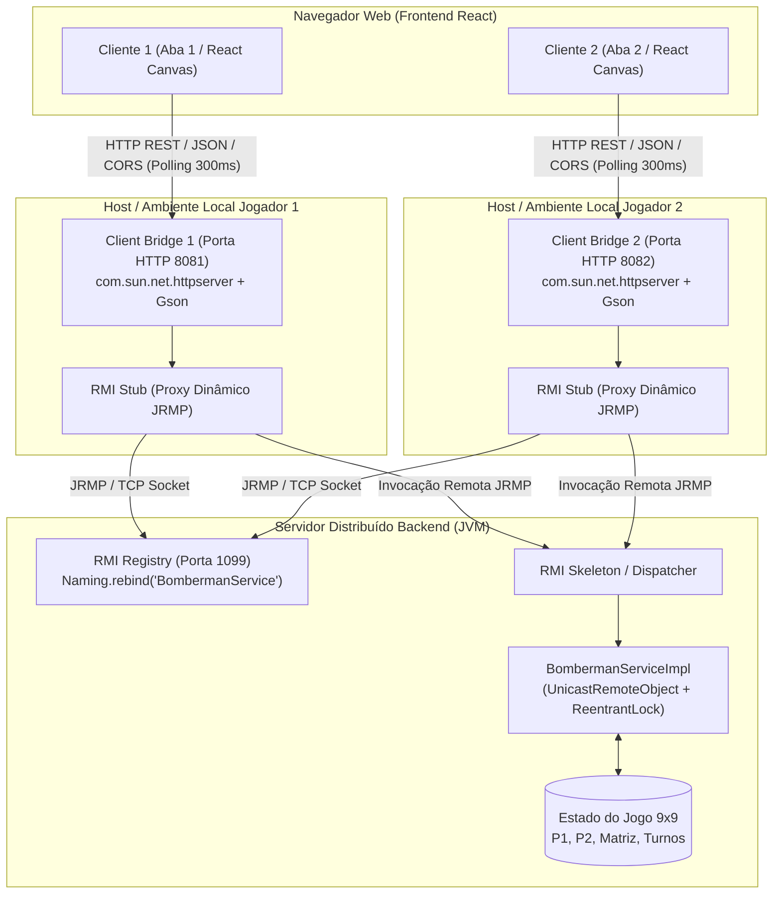
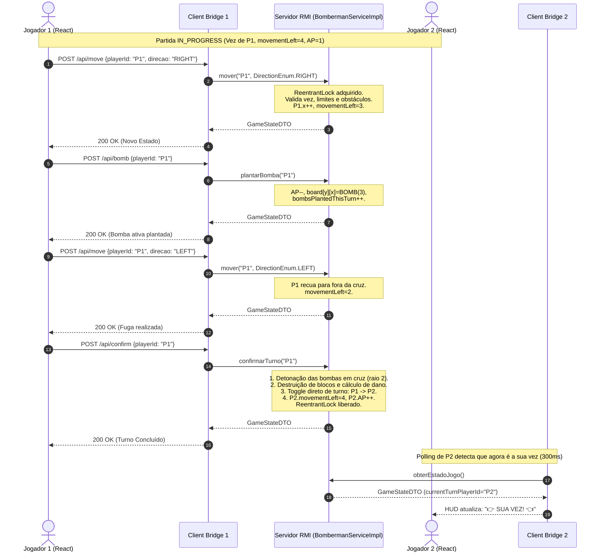
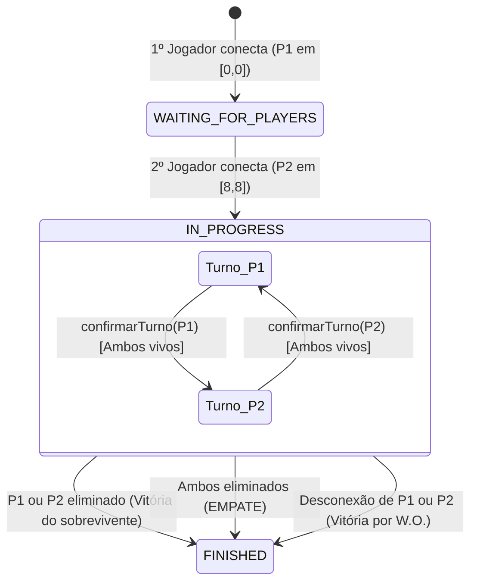

# Relatório Técnico: Bomberman 1v1 Multiplayer em Turnos
**Disciplina:** Sistemas Distribuídos  
**Tecnologias:** Java RMI (Java 17/21), JRMP, Local HTTP Bridge (`com.sun.net.httpserver`), React 18, TypeScript, HTML5 Canvas  

---

## 1. Introdução

O presente projeto consiste no desenvolvimento de uma versão distribuída, baseada em turnos, do clássico jogo **Bomberman**, adaptada especificamente para partidas competitivas no formato **1v1 estrito (exatamente dois jogadores)** em um tabuleiro matricial de dimensões **9x9**. 

Diferente do Bomberman tradicional em tempo real contínuo, a abordagem em turnos discretos com **Action Points (AP / Estoque de Bombas) acumuláveis** e passos por turno (`movementLeft = 4`) introduz um forte componente estratégico tático. A mecânica de detonação em duas etapas (Opção de Commit do Turno) permite que um jogador posicione bombas, movimente-se para fora do raio letal da explosão e, ao emitir a confirmação de encerramento de turno, acione a deflagração em cruz de todas as cargas ativas, calculando danos a obstáculos e oponentes. Caso decida economizar recursos e não plantar bombas em sua rodada, o jogador é bonificado com `+1 AP` extra de bônus (além da recarga base de `+1 AP` ao início do próximo turno), incentivando o planejamento de emboscadas e o gerenciamento criterioso de recursos até o teto `MAX_AP = 5`.

### Justificativa da Escolha do Java RMI
A escolha do **Java Remote Method Invocation (RMI)** fundamenta-se nos princípios canônicos de transparência de localização e chamada de procedimento remoto (RPC orientado a objetos):
1. **Transparência de Acesso e Localização:** O modelo de objetos remotos do Java RMI permite que o cliente interaja com a instância remota do jogo como se fosse um objeto local na JVM, desacoplando a semântica da aplicação dos detalhes de transporte de baixo nível (sockets TCP/IP).
2. **Serialização Nativa Tipada:** O RMI provê marshaling e unmarshaling automático de tipos complexos e grafos de objetos serializáveis (`GameStateDTO`, `PlayerDTO`, `DirectionEnum`, exceções customizadas) através do protocolo binário nativo **JRMP (Java Remote Method Protocol)**, garantindo integridade de tipos e validação estrita em tempo de compilação e execução.
3. **Controle Centralizado e Autoridade do Servidor:** Como o estado do tabuleiro e a lógica crítica de colisão, detonação e máquina de turnos residem integralmente no servidor remoto, evita-se qualquer vulnerabilidade de adulteração ou inconsistência de estado por clientes maliciosos (*cheating*).

---

## 2. Arquitetura da Solução

### 2.1. Topologia Distribuída e Papel do Local HTTP Bridge
Aplicações modernas executadas em navegadores web operam em uma *sandbox* restrita que impossibilita a abertura direta de *raw sockets* TCP binários exigidos pelo protocolo JRMP do RMI. Para solucionar essa restrição arquitetural sem comprometer a essência do RMI no backend, foi implementado o padrão de projeto **Local HTTP Adapter / Bridge**:



- Cada jogador sobe um processo Java leve `ClientBridgeMain` que realiza o `Naming.lookup` no servidor RMI remoto, obtém a referência do `IBombermanService` e sobe um servidor HTTP embarcado (`com.sun.net.httpserver.HttpServer`) local expondo endpoints REST/JSON com cabeçalhos CORS completos.
- O frontend React se comunica exclusivamente com o seu Bridge local via requisições HTTP rápidas, realizando requisições pontuais de ação e *polling* contínuo a cada 300ms em `GET /api/state`.

### 2.2. Diagrama de Sequência do Ciclo de Turno

O diagrama a seguir detalha a interação durante um turno completo de jogo:



---

## 3. Especificação das Interfaces Remotas

A interface `shared.IBombermanService` estende `java.rmi.Remote` e define todos os contratos de invocação remota disponibilizados pelo servidor. Todos os métodos declaram explicitamente `RemoteException` em conformidade com as regras do subsistema RMI.

| Método Remoto | Parâmetros | Tipo de Retorno | Exceções Remotas Lançadas | Descrição e Regras |
| :--- | :--- | :--- | :--- | :--- |
| `conectarJogador` | `String nome` | `PlayerDTO` | `RemoteException`, `GameFullException` | Registra até 2 jogadores (`P1` em `[0,0]`, `P2` em `[8,8]`). O 1º jogador coloca o jogo em `WAITING_FOR_PLAYERS`. A chegada do 2º jogador transiciona o estado para `IN_PROGRESS` e define `P1` na vez. Qualquer 3ª chamada lança `GameFullException`. |
| `mover` | `String playerId`, `DirectionEnum direcao` | `GameStateDTO` | `RemoteException`, `GameNotStartedException`, `InvalidTurnException`, `NoMovementLeftException`, `CollisionException` | Valida se a partida está `IN_PROGRESS` e se é o turno do jogador. Consome `1` de `movementLeft`. Rejeita colisões contra paredes fixas (`1`), blocos destrutíveis (`2`), bombas ativas (`3`) e limites do tabuleiro 9x9. |
| `plantarBomba` | `String playerId` | `GameStateDTO` | `RemoteException`, `GameNotStartedException`, `InvalidTurnException`, `InsufficientApException` | Ação irreversível. Consome `1 AP` (`ap--`), incrementa `bombsPlantedThisTurn++` e posiciona a bomba (`3`) na coordenada do jogador. Não encerra o turno, permitindo fuga. |
| `confirmarTurno` | `String playerId` | `GameStateDTO` | `RemoteException`, `GameNotStartedException`, `InvalidTurnException` | **Fase 1:** Detona todas as bombas ativas em cruz (raio 2), destruindo blocos e eliminando jogadores atingidos. <br>**Fase 2:** Concede `+1 AP` de bônus caso `bombsPlantedThisTurn == 0`. <br>**Fase 3:** Verifica condições de vitória ou alterna diretamente o turno para o oponente (`movementLeft=4`, recarga base `+1 AP`). |
| `obterEstadoJogo` | *Nenhum* | `GameStateDTO` | `RemoteException` | Retorna um instantâneo (*snapshot*) imutável do tabuleiro 9x9, posições e atributos dos jogadores, jogador da vez e mensagens de eventos. Utilizado no polling do cliente. |
| `desconectarJogador` | `String playerId` | `void` | `RemoteException` | Caso ocorra durante `IN_PROGRESS`, declara vitória por W.O. para o jogador remanescente (`status = FINISHED`, `winnerId = opponent`). Se ocorrer em espera, remove o jogador. |

---

## 4. Tratamento de Concorrência e Estado do Jogo

### 4.1. Concorrência no RMI e Fair ReentrantLock
No Java RMI, cada invocação remota recebida pelo esqueleto (*skeleton/dispatcher*) é despachada para execução concorrente em uma thread pertencente ao *thread pool* do RMI Runtime. Caso múltiplos clientes invoquem métodos simultaneamente (como um comando de movimento do jogador ativo concorrendo com polling contínuo de `obterEstadoJogo` do oponente), podem ocorrer condições de corrida (*race conditions*), visualizações de leituras sujas (*dirty reads*) e corrupção de memória no tabuleiro.

Para garantir a **linearizabilidade**, **consistência sequencial** e **ausência de inanição (*starvation*)**, o `BombermanServiceImpl` utiliza um lock reentrante com garantia de justiça (*fair lock*):

```java
private final ReentrantLock lock = new ReentrantLock(true);
```

Todas as operações de mutação e consulta crítica são encapsuladas estritamente sob o padrão idiomático de proteção:

```java
lock.lock();
try {
    validateTurn(playerId);
    clearFireIfAny();
    // Execução atômica das regras de negócio
    return snapshot();
} finally {
    lock.unlock();
}
```

A passagem do parâmetro `true` no construtor do `ReentrantLock` instrui a JVM a conceder o acesso à thread que estiver esperando há mais tempo na fila do monitor, impedindo que rajadas de requisições de leitura de polling monopolizem o lock em detrimento das jogadas ativas.

### 4.2. Máquina de Estados e Validação Estrita de Turnos
O ciclo de vida do jogo é governado pelo enum `GameStatusEnum` composto por três estados discretos:
- `WAITING_FOR_PLAYERS`: Estado inicial com 0 ou 1 jogador. O método `validateTurn` rejeita prontamente qualquer tentativa de `mover`, `plantarBomba` ou `confirmarTurno` lançando a exceção tipada `GameNotStartedException`.
- `IN_PROGRESS`: Partida ativa iniciada atomicamente assim que o segundo jogador conecta. Apenas o jogador cujo ID coincide com `currentTurnPlayerId` tem permissão de executar comandos de ação. Qualquer requisição oriunda do jogador inativo resulta em `InvalidTurnException`.
- `FINISHED`: Ocorre quando um ou ambos os jogadores são eliminados por explosão ou por desconexão/W.O.



---

## 5. Manual de Compilação e Execução

### 5.1. Pré-requisitos
- **Java Development Kit (JDK):** Versão 17 ou 21 instalada e configurada no `PATH`.
- **Apache Maven:** Versão 3.8+ instalada.
- **Node.js & npm:** Versão 18+ (Node v20+ recomendado).

### 5.2. Compilação do Backend
No diretório raiz do projeto, acesse o diretório do backend e execute a compilação e os testes unitários automatizados:

```bash
cd backend-rmi
mvn clean compile test
```

### 5.3. Execução do Servidor RMI
Para permitir conexões tanto locais quanto via rede local (LAN), exporte a propriedade de sistema `-Djava.rmi.server.hostname` com o IP da interface de rede da máquina servidora:

```bash
# Execução na máquina servidora (Porta padrão RMI 1099)
java -Djava.rmi.server.hostname=127.0.0.1 -cp target/classes:$(mvn dependency:build-classpath | grep -v '\[INFO\]' | tr '\n' ':') server.ServerMain 1099
```
*Alternativamente, via plugin de execução do Maven:*
```bash
mvn exec:java -Dexec.mainClass="server.ServerMain" -Dexec.args="1099"
```

### 5.4. Execução dos Client Bridges (Dois Jogadores)
Para testar a partida 1v1 localmente em abas distintas, inicialize duas instâncias do `ClientBridgeMain`, mapeando cada uma para uma porta HTTP local diferente:

**Terminal 1 (Bridge do Jogador 1 na porta 8081):**
```bash
cd backend-rmi
java -cp target/classes:$(mvn dependency:build-classpath | grep -v '\[INFO\]' | tr '\n' ':') clientbridge.ClientBridgeMain -httpPort 8081 -rmiPort 1099 -rmiHost localhost
```

**Terminal 2 (Bridge do Jogador 2 na porta 8082):**
```bash
cd backend-rmi
java -cp target/classes:$(mvn dependency:build-classpath | grep -v '\[INFO\]' | tr '\n' ':') clientbridge.ClientBridgeMain -httpPort 8082 -rmiPort 1099 -rmiHost localhost
```

### 5.5. Execução do Frontend React
Em um novo terminal, entre na pasta do frontend, instale as dependências e inicie o servidor de desenvolvimento Vite:

```bash
cd frontend
npm install
npm run dev
```

Abra o navegador em `http://localhost:3000`:
- **Aba 1 (Jogador 1):** Mantenha a URL do Bridge como `http://localhost:8081`, digite seu nome e clique em "Conectar e Jogar". O jogo exibirá o status `WAITING_FOR_PLAYERS`.
- **Aba 2 (Jogador 2):** Altere a URL do Bridge no topo para `http://localhost:8082`, digite o nome do Jogador 2 e conecte-se. O jogo iniciará imediatamente (`IN_PROGRESS`), liberando os controles para `P1`.

---

## 6. Conclusão e Autoavaliação

### 6.1. Dificuldades Técnicas e Soluções Adotadas
1. **Restrições de Socket do Navegador vs. Protocolo JRMP:** A incompatibilidade fundamental entre a sandbox web dos browsers modernos (que suporta apenas HTTP/WebSocket) e o protocolo de transporte binário nativo do Java RMI exigiu uma reflexão arquitetural. A introdução do **Local HTTP Bridge** demonstrou ser uma solução elegante e canônica de sistemas distribuídos, preservando integralmente o uso de interfaces `Remote`, `UnicastRemoteObject` e semântica de RMI no cerne da solução sem violar as restrições dos clientes.
2. **Serialização e Integridade de Exceções:** Garantir que exceções de negócio (`GameNotStartedException`, `InsufficientApException`, `CollisionException`, `InvalidTurnException`) fossem serializáveis no RMI e adequadamente capturadas pelo bridge para retorno de códigos HTTP 400 com mensagens amigáveis em JSON.
3. **Cálculo da Detonação em Cruz e Barreira de Propagação:** A mecânica de explosão de alcance 2 exigiu um algoritmo rigoroso para interromper a propagação imediatamente ao colidir com paredes indestrutíveis (`1`), enquanto blocos destrutíveis (`2`) devem ser destruídos e convertidos em fogo (`4`), interrompendo a propagação posterior na mesma direção.

### 6.2. Relato do Uso de Ferramentas de Inteligência Artificial
A utilização de IA durante o projeto foi direcionada principalmente à concepção visual do Canvas HTML5 no frontend e à aceleração do boilerplate de integração:
- **Canvas e Física Visual:** A IA auxiliou na parametrização matemática dos gradientes radiais, cálculo vetorial das faíscas animadas das bombas e na projeção da **área de perigo translúcida pulsante** (danger zone), simulando com precisão a cruz de detonação antes da confirmação do turno.
- **Estruturação Formal do Relatório:** Auxílio na formatação dos diagramas arquiteturais Mermaid e na síntese da máquina de estados distribuída.
- **Aperfeiçoamento dos Testes:** A geração de suítes de testes automatizados com JUnit 5 permitiu validar casos de borda como fuga em "L" e empates simultâneos com alto rigor conceitual.
