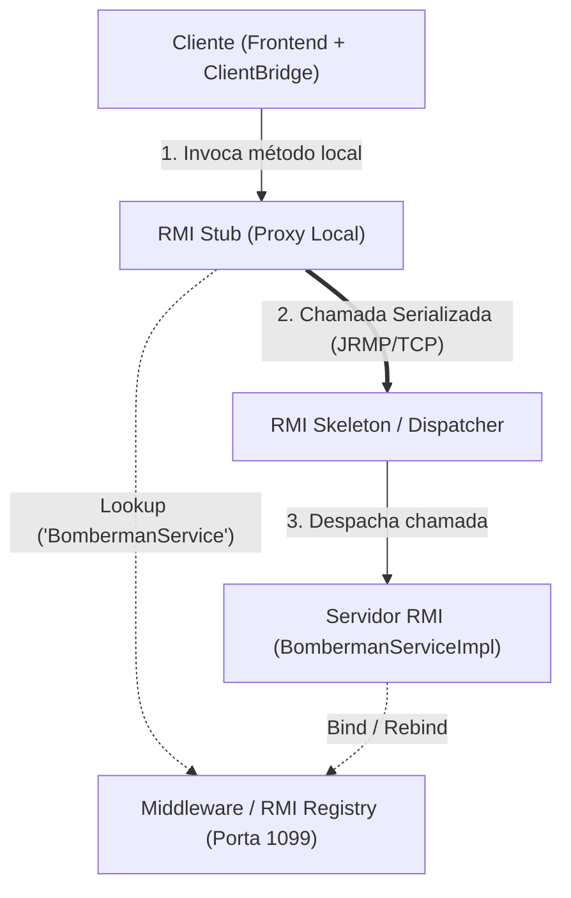
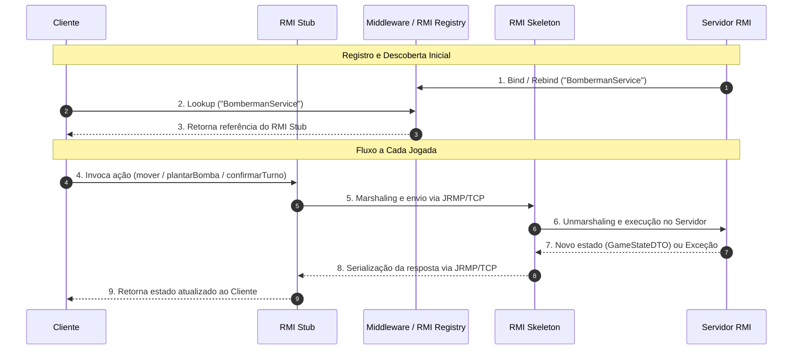
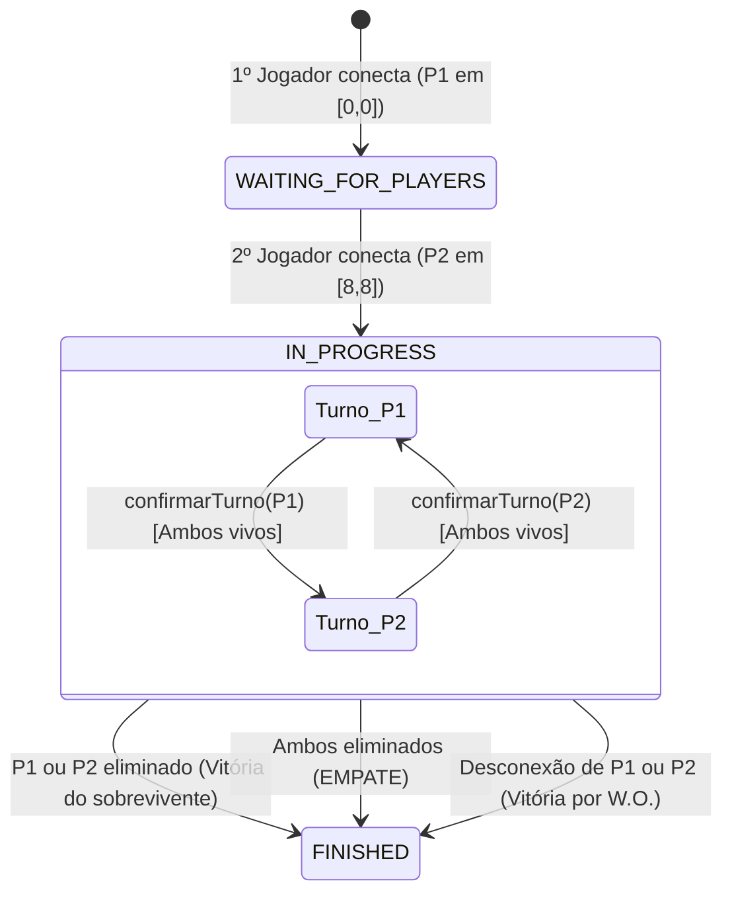

# Relatório Técnico: Bomberman 1v1 Multiplayer em Turnos
**Disciplina:** Sistemas Distribuídos  
**Tecnologias:** Java RMI (Java 17/21), JRMP, Local HTTP Bridge (`com.sun.net.httpserver`), React 18, TypeScript, HTML5 Canvas  

---

## 1. Introdução

### 1.1. Descrição do Jogo Escolhido
O presente projeto consiste no desenvolvimento de uma versão distribuída, baseada em turnos, do clássico jogo **Bomberman**, adaptada especificamente para partidas competitivas no formato **1v1 estrito (exatamente dois jogadores)** em um tabuleiro matricial de dimensões **9x9**.

Diferente do Bomberman tradicional em tempo real contínuo, a abordagem em turnos discretos usa regras fixas de **4 passos (`movementLeft`) e 1 bomba por turno (`AP`)**:
- **Mapa e Spawns:** O tabuleiro `9x9` possui paredes fixas indestrutíveis (`1`) nas coordenadas onde linha e coluna são ambas ímpares, blocos destrutíveis (`2`) gerados nas demais posições e zonas seguras de nascimento: o **Jogador 1 (`P1`)** inicia no canto superior esquerdo `[0,0]` (com `[0,1]` e `[1,0]` livres) e o **Jogador 2 (`P2`)** inicia no canto inferior direito `[8,8]` (com `[8,7]` e `[7,8]` livres).
- **Mecânica de Turno e Fuga:** No seu turno, o jogador pode se mover ortogonalmente consumindo seus passos disponíveis (`movementLeft`) e plantar bombas na sua posição atual consumindo `1 AP` por bomba. Plantar uma bomba **não encerra o turno imediatamente**, permitindo que o jogador utilize seus passos restantes para fugir em "L" do raio letal da explosão.
- **Confirmação do Turno (`confirmarTurno`) e Detonação:** Ao emitir a confirmação de encerramento de turno, todas as bombas ativas no tabuleiro detonam simultaneamente em formato de cruz (alcance de 2 casas em cada direção ortogonal). Paredes indestrutíveis bloqueiam o fogo; blocos destrutíveis são destruídos e interrompem a propagação naquela direção; jogadores atingidos pelo fogo são eliminados.
- **Limite por turno:** Cada jogador recebe **4 passos e 1 bomba**. Ao passar a vez, o servidor restaura esses valores para o próximo jogador; eles não escalam ao longo da partida.

### 1.2. Motivação da Escolha do Protocolo (Java RMI)
A escolha do **Java Remote Method Invocation (Java RMI)** — implementação orientada a objetos do paradigma RPC (Remote Procedure Call) nativa da plataforma Java — fundamenta-se nos seguintes princípios técnicos e arquiteturais:
1. **Transparência de Acesso e Localização:** O modelo de objetos remotos do Java RMI permite que o cliente invoque métodos da interface remota `IBombermanService` (`conectarJogador`, `mover`, `plantarBomba`, `confirmarTurno`, `obterEstadoJogo`, `desconectarJogador`, `reiniciarPartida`) com a mesma semântica de uma chamada de método local na JVM, abstraindo a abertura e o gerenciamento manual de sockets TCP/IP.
2. **Tipagem Forte e Serialização Nativa (Marshaling/Unmarshaling):** O RMI provê serialização automática de objetos complexos de transferência de dados (`GameStateDTO`, `PlayerDTO`, `DirectionEnum`, `GameStatusEnum`) através do protocolo binário nativo **JRMP (Java Remote Method Protocol)**, garantindo integridade de tipos em tempo de compilação e execução.
3. **Propagação Semântica de Exceções Remotas:** O RMI permite que violações de regra de negócio detectadas no servidor (`InvalidTurnException`, `CollisionException`, `NoMovementLeftException`, `InsufficientApException`, `GameNotStartedException`, `GameFullException`) sejam lançadas diretamente pelo método remoto e capturadas com tipagem exata no lado do cliente.
4. **Servidor Autoritativo e Controle Centralizado de Concorrência:** Como o estado do tabuleiro `9x9` e a lógica crítica de colisão, detonação e máquina de turnos residem integralmente no objeto remoto `BombermanServiceImpl` protegido por `ReentrantLock(true)`, evita-se qualquer vulnerabilidade de adulteração de estado por clientes (*cheating*) ou condições de corrida.

---

## 2. Arquitetura da Solução

### 2.1. Componentes da Arquitetura (Cliente, Servidor, Stub/Skeleton e Middleware/Registry)
Aplicações modernas executadas em navegadores web operam em uma *sandbox* restrita que impossibilita a abertura direta de *raw sockets* TCP binários exigidos pelo protocolo JRMP do RMI. Para solucionar essa restrição sem comprometer a essência do RMI, foi implementado o padrão **Local HTTP Adapter / Bridge** no lado do cliente:

1. **Interface Gráfica do Cliente (Frontend React + HTML5 Canvas):** Renderiza o tabuleiro `9x9`, o HUD de turno/AP e captura os comandos do jogador, enviando-os via HTTP/JSON para o seu respectivo Client Bridge local e realizando *polling* a cada `300ms` em `GET /api/state`.
2. **Cliente RMI (`ClientBridgeMain`) & RMI Stub:** Processo Java leve executado no ambiente do cliente que consulta o **RMI Registry** e obtém o **RMI Stub** (proxy dinâmico de `IBombermanService`). O Stub atua como representante local do objeto remoto, realizando o *marshaling* (serialização) dos parâmetros e transmitindo a invocação via JRMP/TCP até o servidor.
3. **Middleware / RMI Registry (`LocateRegistry` - Porta `1099`):** Serviço de diretório e nomes onde o servidor registra (`Naming.rebind`) a referência pública do objeto remoto sob a chave `"BombermanService"`. Permite que os clientes localizem e obtenham o Stub em tempo de execução via `Naming.lookup("rmi://host:1099/BombermanService")`.
4. **RMI Skeleton / Dispatcher (Runtime RMI no Servidor):** Camada interna do middleware RMI no lado do servidor que recebe as chamadas binárias JRMP enviadas pelo Stub, realiza o *unmarshaling* (desserialização) dos argumentos, despacha a execução para uma thread do servidor invocando o método real em `BombermanServiceImpl` e serializa o retorno (ou exceção) de volta para o Stub.
5. **Servidor RMI (`ServerMain` e `BombermanServiceImpl`):** Estende `UnicastRemoteObject` e implementa `IBombermanService`. Mantém em memória a matriz `9x9`, o estado dos jogadores `P1` e `P2` e garante exclusão mútua justa através de `ReentrantLock(true)`.

### 2.2. Diagrama da Arquitetura (Mermaid)



### 2.3. Fluxo de Mensagens a Cada Jogada (Mermaid)

O diagrama de sequência a seguir ilustra o fluxo essencial a cada jogada:



#### Explicação Passo a Passo do Fluxo a Cada Jogada:
1. **Descoberta Inicial (`Bind` & `Lookup`):** Ao iniciar, o `ServerMain` instancia `BombermanServiceImpl` e o registra no **RMI Registry** (`porta 1099`). O `ClientBridgeMain` de cada jogador consulta o Registry via `Naming.lookup("rmi://localhost:1099/BombermanService")` e recebe a instância serializada do **RMI Stub**.
2. **Captura do Comando no Cliente:** Quando o jogador da vez realiza uma ação na interface web (mover com `WASD`/setas, plantar bomba com `Espaço` ou confirmar turno com `Enter`), o React envia uma requisição HTTP `POST` com payload JSON para o seu `ClientBridgeMain` local.
3. **Serialização no Stub (*Marshaling*):** O `ClientBridgeMain` invoca o método equivalente na referência local do **RMI Stub** (ex.: `stub.mover(playerId, DirectionEnum.RIGHT)`). O Stub empacota o identificador do método e serializa os parâmetros em fluxo binário, transmitindo-os sobre TCP/IP utilizando o protocolo **JRMP**.
4. **Recepção no Skeleton (*Unmarshaling*) e Execução Sincronizada:** O **RMI Skeleton/Dispatcher** no servidor lê os bytes do socket JRMP, desserializa os argumentos e invoca o método no objeto real `BombermanServiceImpl`. A thread adquire o `ReentrantLock(true)`, valida o estado da partida (`IN_PROGRESS`), verifica se o `playerId` é o dono do turno atual (`currentTurnPlayerId`) e aplica as regras de colisão, saldo de movimentos ou detonação na matriz `9x9`.
5. **Resposta Serializada ou Tratamento de Exceção:**
   - **Jogada Válida:** O método constrói um novo snapshot imutável `GameStateDTO` contendo a matriz `9x9` atualizada, o estado de `P1` e `P2` e o log da jogada. O Skeleton serializa o `GameStateDTO` via JRMP de volta ao Stub, que o entrega ao `ClientBridgeMain` para conversão em JSON (`HTTP 200 OK`) e imediata re-renderização no Canvas HTML5.
   - **Jogada Inválida:** Caso ocorra violação de regra (ex.: tentar andar contra parede fixa ou jogar fora do turno), `BombermanServiceImpl` lança uma exceção verificada (`CollisionException`, `InvalidTurnException`, etc.). O Skeleton serializa a exceção via JRMP, o Stub a relança no cliente Java, e o `ClientBridgeMain` a traduz em resposta `HTTP 400 Bad Request` exibida como alerta visual na interface.
6. **Sincronização Contínua do Oponente:** Enquanto um jogador executa suas ações, o cliente do adversário realiza chamadas periódicas a `obterEstadoJogo()` (a cada `300ms`), recebendo via Stub/Skeleton o `GameStateDTO` atualizado e refletindo na tela cada passo, bomba plantada, explosão e troca de turno.

---

## 3. Especificação das Interfaces Remotas

A interface `shared.IBombermanService` estende `java.rmi.Remote` e define todos os contratos de invocação remota disponibilizados pelo servidor. Todos os métodos declaram explicitamente `RemoteException` em conformidade com as regras do subsistema RMI.

| Método Remoto | Parâmetros | Tipo de Retorno | Exceções Remotas Lançadas | Descrição e Regras |
| :--- | :--- | :--- | :--- | :--- |
| `conectarJogador` | `String nome` | `PlayerDTO` | `RemoteException`, `GameFullException` | Registra até 2 jogadores (`P1` em `[0,0]`, `P2` em `[8,8]`). O 1º jogador coloca o jogo em `WAITING_FOR_PLAYERS`. A chegada do 2º jogador transiciona o estado para `IN_PROGRESS` e define `P1` na vez. Qualquer 3ª chamada lança `GameFullException`. |
| `mover` | `String playerId`, `DirectionEnum direcao` | `GameStateDTO` | `RemoteException`, `GameNotStartedException`, `InvalidTurnException`, `NoMovementLeftException`, `CollisionException` | Valida se a partida está `IN_PROGRESS` e se é o turno do jogador. Consome `1` de `movementLeft`. Rejeita colisões contra paredes fixas (`1`), blocos destrutíveis (`2`), bombas ativas (`3`) e limites do tabuleiro 9x9. |
| `plantarBomba` | `String playerId` | `GameStateDTO` | `RemoteException`, `GameNotStartedException`, `InvalidTurnException`, `InsufficientApException` | Ação irreversível. Consome `1 AP` (`ap--`), incrementa `bombsPlantedThisTurn++` e posiciona a bomba (`3`) na coordenada do jogador. Não encerra o turno, permitindo fuga. |
| `confirmarTurno` | `String playerId` | `GameStateDTO` | `RemoteException`, `GameNotStartedException`, `InvalidTurnException` | **Fase 1:** Detona todas as bombas ativas em cruz (raio 2), destruindo blocos e eliminando jogadores atingidos. <br>**Fase 2:** Zera `bombsPlantedThisTurn`. <br>**Fase 3:** Verifica condições de vitória ou alterna a vez e restaura 4 passos e 1 bomba para o próximo jogador. |
| `obterEstadoJogo` | *Nenhum* | `GameStateDTO` | `RemoteException` | Retorna um instantâneo (*snapshot*) imutável do tabuleiro 9x9, posições e atributos dos jogadores, jogador da vez e mensagens de eventos. Utilizado no polling do cliente. |
| `desconectarJogador` | `String playerId` | `void` | `RemoteException` | Caso ocorra durante `IN_PROGRESS`, remove quem saiu e declara vitória por W.O. ao jogador restante (`status = FINISHED`, `winnerId = opponent`). Se ocorrer em espera, remove o jogador. |
| `reiniciarPartida` | *Nenhum* | `GameStateDTO` | `RemoteException`, `InvalidTurnException` | Só aceita `FINISHED`. Reinicia com os dois jogadores presentes; depois de um W.O., preserva o sobrevivente e volta a `WAITING_FOR_PLAYERS` até um novo oponente conectar. |

---

## 4. Tratamento de Concorrência e Estado do Jogo

### 4.1. Concorrência no RMI e Fair ReentrantLock
No Java RMI, cada invocação remota recebida pelo esqueleto (*skeleton/dispatcher*) é despachada para execução concorrente em uma thread pertencente ao *thread pool* do RMI Runtime. Caso múltiplos clientes invoquem métodos simultaneamente (como um comando de movimento do jogador ativo concorrendo com polling contínuo de `obterEstadoJogo` do oponente), podem ocorrer condições de corrida (*race conditions*), visualizações de leituras sujas (*dirty reads*) e corrupção de memória no tabuleiro.

Para garantir a **linearizabilidade**, **consistência sequencial** e **ausência de inanição (*starvation*)**, o `BombermanServiceImpl` utiliza um lock reentrante com garantia de justiça (*fair lock*):

```java
private final ReentrantLock lock = new ReentrantLock(true);
```

Todas as operações de mutação e consulta crítica são encapsuladas estritamente sob o padrão idiomático de proteção:

```java
lock.lock();
try {
    validateTurn(playerId);
    clearFireIfAny();
    // Execução atômica das regras de negócio
    return snapshot();
} finally {
    lock.unlock();
}
```

A passagem do parâmetro `true` no construtor do `ReentrantLock` instrui a JVM a conceder o acesso à thread que estiver esperando há mais tempo na fila do monitor, impedindo que rajadas de requisições de leitura de polling monopolizem o lock em detrimento das jogadas ativas.

### 4.2. Máquina de Estados e Validação Estrita de Turnos
O ciclo de vida do jogo é governado pelo enum `GameStatusEnum` composto por três estados discretos:
- `WAITING_FOR_PLAYERS`: Estado inicial com 0 ou 1 jogador. O método `validateTurn` rejeita prontamente qualquer tentativa de `mover`, `plantarBomba` ou `confirmarTurno` lançando a exceção tipada `GameNotStartedException`.
- `IN_PROGRESS`: Partida ativa iniciada atomicamente assim que o segundo jogador conecta. Apenas o jogador cujo ID coincide com `currentTurnPlayerId` tem permissão de executar comandos de ação. Qualquer requisição oriunda do jogador inativo resulta em `InvalidTurnException`.
- `FINISHED`: Ocorre quando um ou ambos os jogadores são eliminados por explosão ou por desconexão/W.O.



---

## 5. Manual de Compilação e Execução

### 5.1. Pré-requisitos
- **Java Development Kit (JDK):** Versão 17 ou 21 instalada e configurada no `PATH`.
- **Apache Maven:** Versão 3.8+ instalada.
- **Node.js & npm:** Versão 18+ (Node v20+ recomendado).

### 5.2. Compilação do Backend
No diretório raiz do projeto, acesse o diretório do backend e execute a compilação e os testes unitários automatizados:

```bash
cd backend-rmi
mvn clean compile test
```

### 5.3. Execução do Servidor RMI
Para permitir conexões tanto locais quanto via rede local (LAN), exporte a propriedade de sistema `-Djava.rmi.server.hostname` com o IP da interface de rede da máquina servidora:

```bash
# Execução na máquina servidora (Porta padrão RMI 1099)
java -Djava.rmi.server.hostname=127.0.0.1 -cp target/classes:$(mvn dependency:build-classpath | grep -v '\[INFO\]' | tr '\n' ':') server.ServerMain 1099
```
*Alternativamente, via plugin de execução do Maven:*
```bash
mvn exec:java -Dexec.mainClass="server.ServerMain" -Dexec.args="1099"
```

### 5.4. Execução dos Client Bridges (Dois Jogadores)
Para testar a partida 1v1 localmente em abas distintas, inicialize duas instâncias do `ClientBridgeMain`, mapeando cada uma para uma porta HTTP local diferente:

**Terminal 1 (Bridge do Jogador 1 na porta 8081):**
```bash
cd backend-rmi
java -cp target/classes:$(mvn dependency:build-classpath | grep -v '\[INFO\]' | tr '\n' ':') clientbridge.ClientBridgeMain -httpPort 8081 -rmiPort 1099 -rmiHost localhost
```

**Terminal 2 (Bridge do Jogador 2 na porta 8082):**
```bash
cd backend-rmi
java -cp target/classes:$(mvn dependency:build-classpath | grep -v '\[INFO\]' | tr '\n' ':') clientbridge.ClientBridgeMain -httpPort 8082 -rmiPort 1099 -rmiHost localhost
```

### 5.5. Execução do Frontend React
Em um novo terminal, entre na pasta do frontend, instale as dependências e inicie o servidor de desenvolvimento Vite:

```bash
cd frontend
npm install
npm run dev
```

Abra o navegador em `http://localhost:3000`:
- **Aba 1 (Jogador 1):** Mantenha a URL do Bridge como `http://localhost:8081`, digite seu nome e clique em "Conectar e Jogar". O jogo exibirá o status `WAITING_FOR_PLAYERS`.
- **Aba 2 (Jogador 2):** Altere a URL do Bridge no topo para `http://localhost:8082`, digite o nome do Jogador 2 e conecte-se. O jogo iniciará imediatamente (`IN_PROGRESS`), liberando os controles para `P1`.

---

## 6. Conclusão e Autoavaliação

### 6.1. Dificuldades Técnicas e Soluções Adotadas
1. **Restrições de Socket do Navegador vs. Protocolo JRMP:** A incompatibilidade fundamental entre a sandbox web dos browsers modernos (que suporta apenas HTTP/WebSocket) e o protocolo de transporte binário nativo do Java RMI exigiu uma reflexão arquitetural. A introdução do **Local HTTP Bridge** demonstrou ser uma solução elegante e canônica de sistemas distribuídos, preservando integralmente o uso de interfaces `Remote`, `UnicastRemoteObject` e semântica de RMI no cerne da solução sem violar as restrições dos clientes.
2. **Serialização e Integridade de Exceções:** Garantir que exceções de negócio (`GameNotStartedException`, `InsufficientApException`, `CollisionException`, `InvalidTurnException`) fossem serializáveis no RMI e adequadamente capturadas pelo bridge para retorno de códigos HTTP 400 com mensagens amigáveis em JSON.
3. **Cálculo da Detonação em Cruz e Barreira de Propagação:** A mecânica de explosão de alcance 2 exigiu um algoritmo rigoroso para interromper a propagação imediatamente ao colidir com paredes indestrutíveis (`1`), enquanto blocos destrutíveis (`2`) devem ser destruídos e convertidos em fogo (`4`), interrompendo a propagação posterior na mesma direção.

### 6.2. Relato do Uso de Ferramentas de Inteligência Artificial
A utilização de IA durante o projeto foi direcionada principalmente à concepção visual do Canvas HTML5 no frontend e à aceleração do boilerplate de integração:
- **Canvas e Física Visual:** A IA auxiliou na parametrização matemática dos gradientes radiais, cálculo vetorial das faíscas animadas das bombas e na projeção da **área de perigo translúcida pulsante** (danger zone), simulando com precisão a cruz de detonação antes da confirmação do turno.
- **Estruturação Formal do Relatório:** Auxílio na formatação dos diagramas arquiteturais Mermaid e na síntese da máquina de estados distribuída.
- **Aperfeiçoamento dos Testes:** A geração de suítes de testes automatizados com JUnit 5 permitiu validar casos de borda como fuga em "L" e empates simultâneos com alto rigor conceitual.
